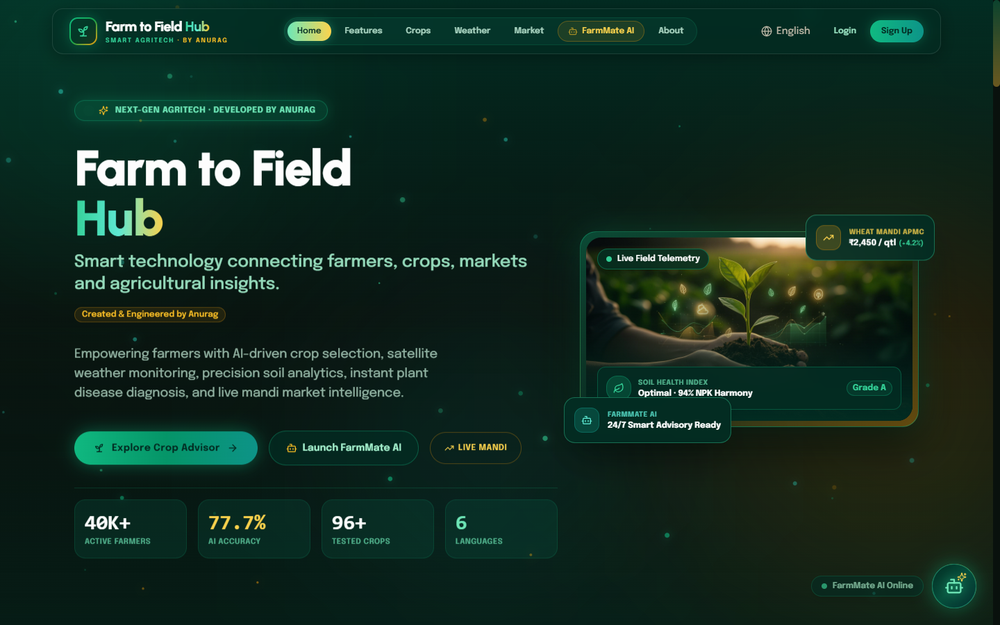
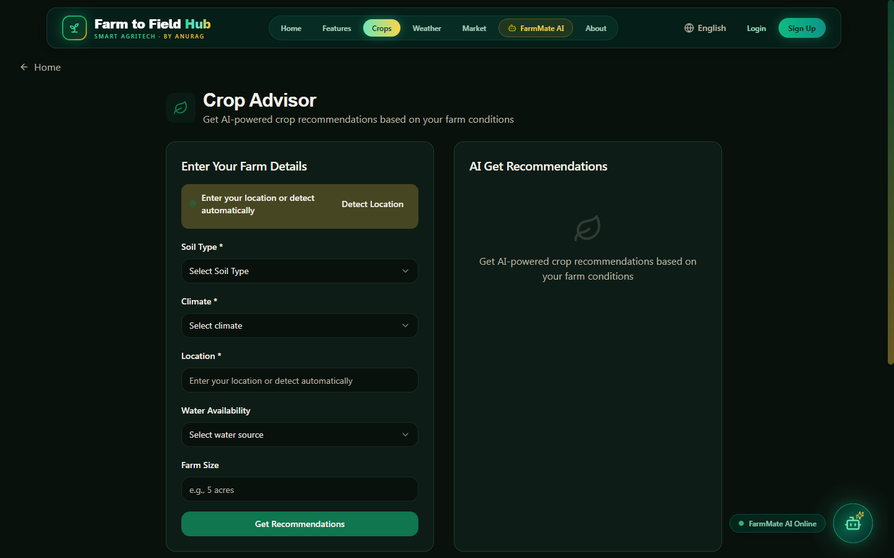

# Farm to Field Hub — Smart Agriculture with AI 🌱🌾

A next-generation **AgriTech web platform** engineered to empower farmers with precision crop recommendations, soil intelligence, satellite meteorological telemetry, plant disease diagnostics, live APMC mandi market trends, and an interactive 3D voice AI assistant.

**Developed by Anurag**  
*Smart technology connecting farmers, crops, markets and agricultural insights.*

---

## 📸 Screenshots

### 1. Modern AgriTech Homepage & Live Telemetry


### 2. AI Crop Advisor & Precision Field Planning


---

## ✨ Key Features

- **🌱 Smart Crop Planning & Advisor**: AI-driven crop selection based on soil chemistry (Alluvial, Black Regur, Red, Laterite), seasonal weather patterns, and market profitability.
- **🤖 FarmMate AI Assistant**: A floating, modern AI farming assistant with voice speech-to-text, text-to-speech audio feedback, and expert agronomic knowledge.
- **🛰️ Live Climate Telemetry**: Real-time satellite weather tracking powered by Open-Meteo, featuring automatic GPS detection, spray window advisories, and soil moisture tracking.
- **📈 APMC Mandi Market Trends**: Real-time wholesale crop commodity prices, trend charts, and selling timing optimization.
- **🦠 Computer Vision Disease Detection**: Leaf photo analysis and early fungal/bacterial blight diagnosis with immediate organic and chemical remedy recommendations.
- **🦾 3D Cyber Robo**: Interactive 3D WebGL farmer avatar with real-time lip-sync, speech synthesis, and multilingual conversational abilities.
- **🌐 Multilingual Accessibility**: Full regional language localization supporting **English, Hindi, Telugu, Tamil, Kannada, and Marathi**.

---

## 🛠️ Technology Stack

- **Frontend Core**: React 18, TypeScript, Vite
- **Styling & Design System**: Tailwind CSS, Emerald Prestige Design Tokens, Glassmorphism, CSS 3D Transforms
- **3D Graphics & Animations**: Three.js, `@react-three/fiber`, `@react-three/drei`
- **Charts & Data Visualization**: Recharts
- **Components & Icons**: Radix UI (shadcn/ui), Lucide React
- **Audio & Speech**: Web Speech API (SpeechRecognition + SpeechSynthesis)
- **Live APIs**: Open-Meteo Satellite Weather API, Supabase

---

## 🚀 Quick Start Guide

### Prerequisites
- Node.js (v18 or higher recommended)
- npm or pnpm

### Installation

1. **Clone the repository**:
   ```bash
   git clone https://github.com/anuragog692-art/Smart-agriculture-with-AI.git
   cd Smart-agriculture-with-AI
   ```

2. **Install dependencies**:
   ```bash
   npm install
   ```

3. **Start the local development server**:
   ```bash
   npm run dev
   ```
   Open [http://localhost:8080](http://localhost:8080) in your browser.

4. **Build for production**:
   ```bash
   npm run build
   ```

5. **Run test suite**:
   ```bash
   npm run test
   ```

---

## 👤 Author & Developer

**Anurag**
- GitHub: [@anuragog692-art](https://github.com/anuragog692-art)
- Project: **Farm to Field Hub — Smart Agriculture with AI**

---

## 📄 License
This project is open source and available under the [MIT License](LICENSE).
